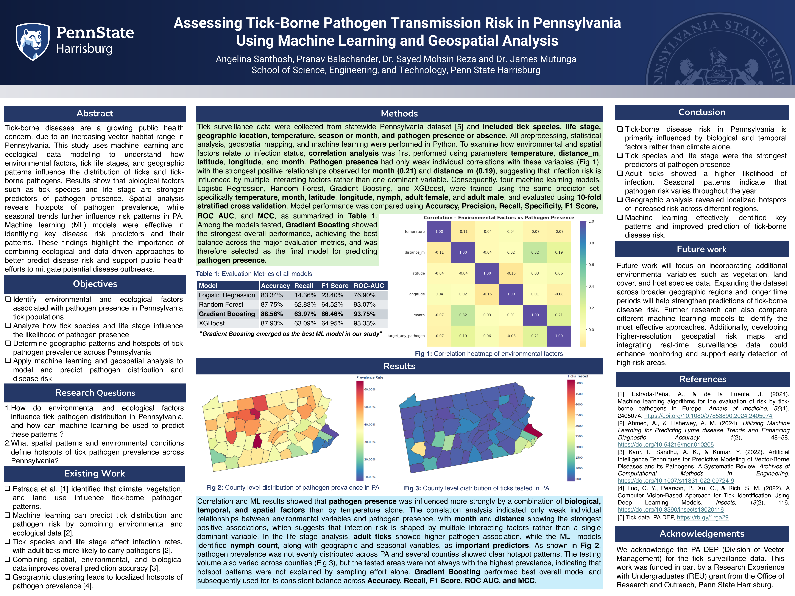

# Assessing Tick-Borne Pathogen Transmission Risk in Pennsylvania Using Machine Learning and Geospatial Analysis

This project benchmarks four machine learning models on statewide Pennsylvania tick surveillance data (2008–2025) to predict pathogen presence, and uses county-level geospatial analysis to identify pathogen hotspots that are not explained by sampling effort alone. Done under the guidance of Dr. Sayed Mohsin Reza and Dr. James Mutunga. 



A full-size PDF of the poster is in [`docs/poster.pdf`](docs/poster.pdf).

## Research questions

1. How do environmental and ecological factors influence tick pathogen distribution in Pennsylvania, and how can machine learning be used to predict these patterns?
2. What spatial patterns and environmental conditions define hotspots of tick pathogen prevalence across Pennsylvania?

## Data

Tick surveillance records from the Pennsylvania DEP (Division of Vector Management), covering 2008–2025. Fields used include species, life stage counts (larvae, nymph, adult male, adult female), collection date, county, latitude/longitude, temperature, distance, number tested, number positive, and detections for individual pathogens (`b_burg`, `a_phag`, `ba_micro`, `bor_miya`).

The target variable is binary: a record is labeled positive if any of `b_burg`, `a_phag`, or `ba_micro` is detected.

The raw dataset is not included in this repository. The notebooks expect a file named `Tick-cdc-report 2008-2025.csv` (read with `pd.read_excel`, so it is an Excel-format file despite the extension). Place your copy in `data/` and update the file path at the top of each notebook (see [Notebooks](#notebooks)).

## Methods

- Preprocessing, statistical analysis, geospatial mapping, and modeling were all done in Python.
- Correlation analysis was run on `temprature`, `distance_m`, `latitude`, `longitude`, and `month` against pathogen presence. All individual correlations were weak (strongest: `month` 0.21, `distance_m` 0.19). Note that `temprature` is spelled this way in the source data.
- Models: Logistic Regression, Random Forest, Gradient Boosting, and XGBoost, trained on the same predictors: `temprature`, `month`, `latitude`, `longitude`, `nymph`, `adult_female`, `adult_male`.
- Evaluation: 10-fold stratified cross-validation (out-of-fold predictions) using Accuracy, Precision, Recall, Specificity, F1, ROC-AUC, and MCC.
- Geospatial analysis: point maps with basemaps, hexbin density maps, and county-level prevalence and testing-effort comparisons.

## Results

| Model | Accuracy | Precision | Recall | Specificity | F1 Score | ROC-AUC | MCC |
|---|---|---|---|---|---|---|---|
| Logistic Regression | 83.34% | 63.19% | 14.36% | 98.20% | 23.40% | 76.90% | 0.2439 |
| Random Forest | 87.75% | 66.32% | 62.83% | 93.12% | 64.52% | 93.07% | 0.5716 |
| **Gradient Boosting** | **88.56%** | **69.17%** | **63.97%** | 93.86% | **66.46%** | **93.75%** | **0.5964** |
| XGBoost | 87.93% | 66.93% | 63.09% | 93.28% | 64.95% | 93.33% | 0.5770 |

- Gradient Boosting gave the best overall balance across metrics and was selected as the final model.
- Logistic Regression has high specificity but very low recall, so it misses most positive records.
- Pathogen presence is shaped by a combination of biological, temporal, and spatial factors rather than temperature alone.
- Adult ticks showed higher pathogen association; nymph count and geographic and seasonal variables were also important predictors.
- Prevalence is uneven across counties, and the highest-prevalence counties are not always the most heavily tested, so hotspots are not explained by sampling effort alone.

## Notebooks

Both notebooks were originally developed on Kaggle and keep their saved outputs.

| Notebook | What it does |
|---|---|
| [`ticks_data_visualization.ipynb`](notebooks/ticks_data_visualization.ipynb) | Exploratory data analysis and mapping. Cleans the data, maps collection locations by species and by year on a basemap, and plots life stages by species, pathogen totals, species-by-pathogen heatmaps, yearly testing and positivity trends, county rankings, and hexbin spatial density. |
| [`graphs_dr_reza.ipynb`](notebooks/graphs_dr_reza.ipynb) | Analysis for the research questions. Builds the pathogen-presence target, ranks predictors (mutual information, Cramér's V, decision-tree rules), compares environmental and life-stage relationships, maps tick distribution against pathogen prevalence, compares 5-year windows and seasons, and runs the four-model benchmark that produces the results table above. |

Source on Kaggle:

- [ticks-data-visualization](https://www.kaggle.com/code/pranavbalachander/ticks-data-visualization)
- [graphs-dr-reza](https://www.kaggle.com/code/pranavbalachander/graphs-dr-reza)

Before running locally, replace the Kaggle input path (`/kaggle/input/...`) in the first cells with the path to your copy of the data, and remove the `!pip install` lines since dependencies come from `requirements.txt`.

## Repository structure

```
.
├── README.md
├── requirements.txt
├── .gitignore
├── notebooks/
│   ├── ticks_data_visualization.ipynb
│   └── graphs_dr_reza.ipynb
├── data/          # raw data, not tracked
├── figures/
└── docs/
    ├── poster.png
    └── poster.pdf
```

## Setup

```bash
git clone <your-repo-url>
cd <repo-name>
python -m venv .venv
source .venv/bin/activate   # Windows: .venv\Scripts\activate
pip install -r requirements.txt
jupyter lab
```

## Future work

Incorporate vegetation, land cover, and host species data; expand to broader regions and longer time periods; compare additional model families; develop higher-resolution risk maps; and integrate real-time surveillance data.

## References

1. Estrada-Peña, A., & de la Fuente, J. (2024). Machine learning algorithms for the evaluation of risk by tick-borne pathogens in Europe. *Annals of Medicine*, 56(1), 2405074. https://doi.org/10.1080/07853890.2024.2405074
2. Ahmed, A., & Elshewey, A. M. (2024). Utilizing Machine Learning for Predicting Lyme disease Trends and Enhancing Diagnostic Accuracy. 1(2), 48–58. https://doi.org/10.54216/mor.010205
3. Kaur, I., Sandhu, A. K., & Kumar, Y. (2022). Artificial Intelligence Techniques for Predictive Modeling of Vector-Borne Diseases and its Pathogens: A Systematic Review. *Archives of Computational Methods in Engineering*. https://doi.org/10.1007/s11831-022-09724-9
4. Luo, C. Y., Pearson, P., Xu, G., & Rich, S. M. (2022). A Computer Vision-Based Approach for Tick Identification Using Deep Learning Models. *Insects*, 13(2), 116. https://doi.org/10.3390/insects13020116

## Acknowledgements

We acknowledge the PA DEP (Division of Vector Management) for the tick surveillance data. This work was funded in part by a Research Experience for Undergraduates (REU) grant from the Office of Research and Outreach, Penn State Harrisburg.
